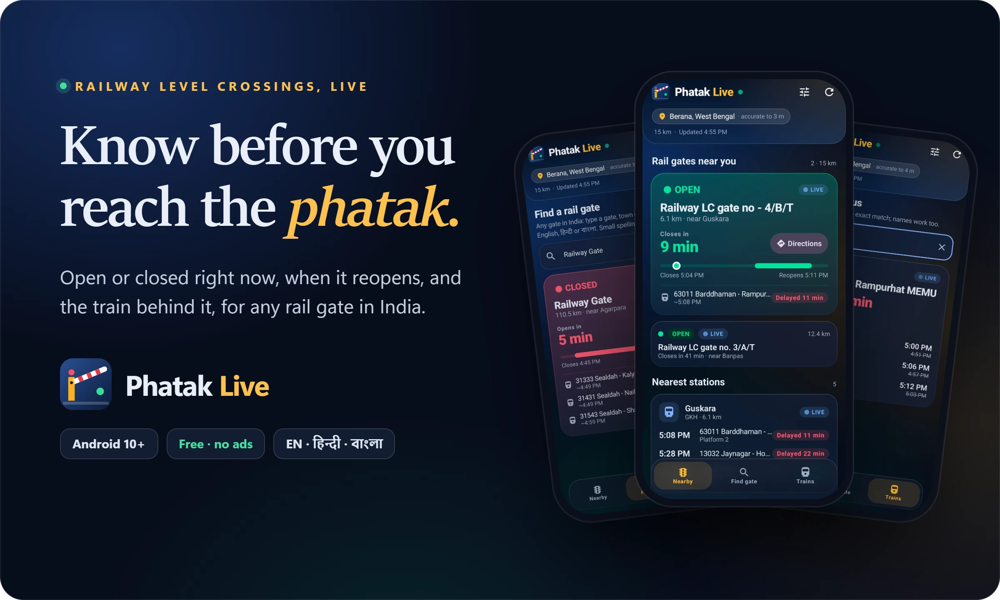
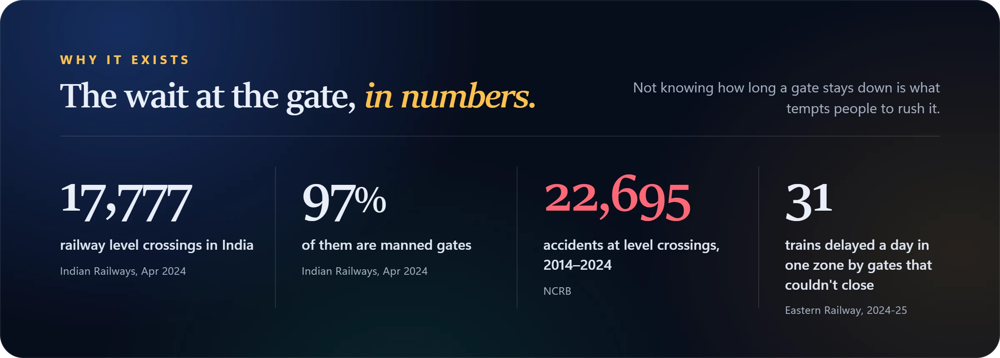
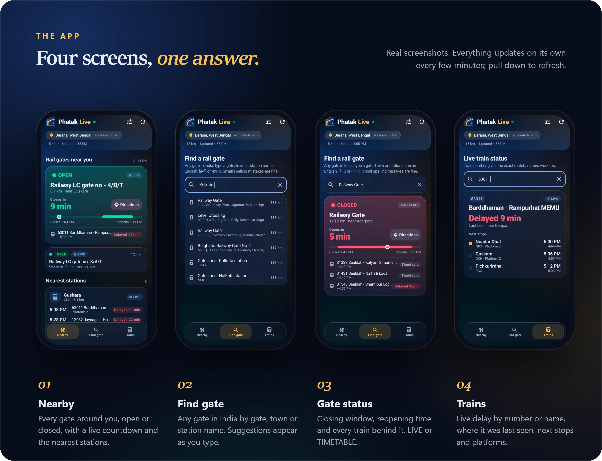
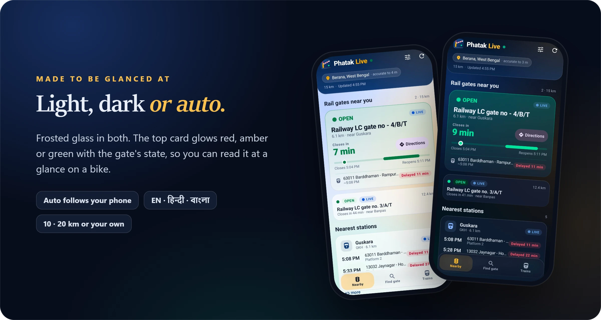
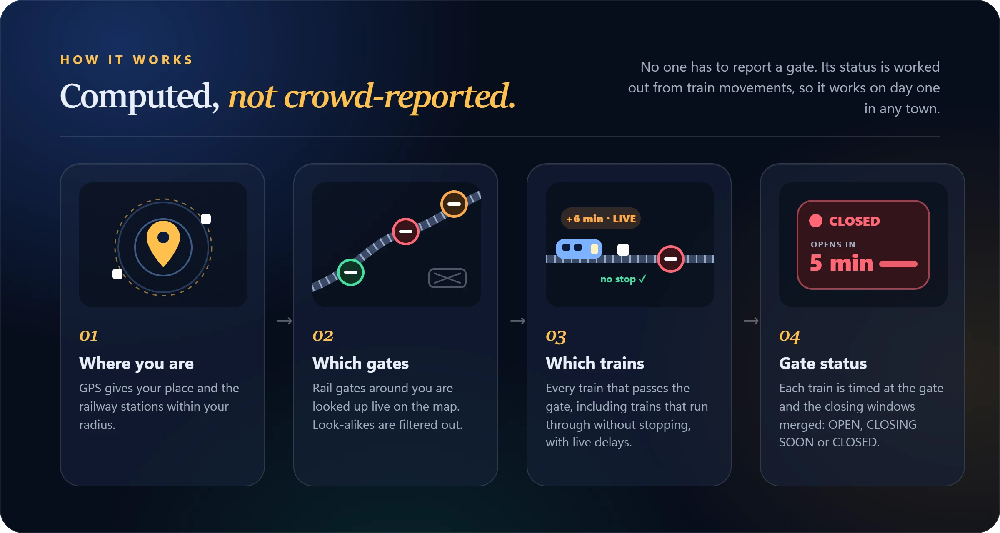
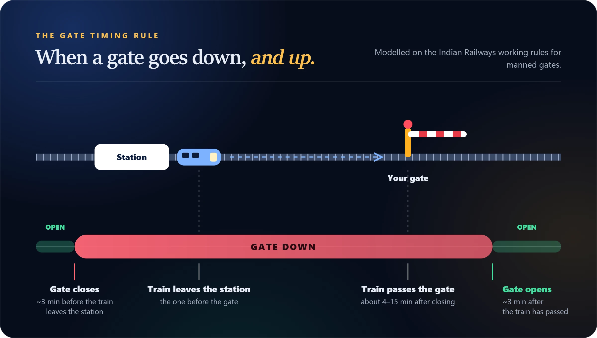

<div align="center">



<br><br>

[](https://github.com/JyotirmoyLaha/phatak-live/releases/latest)


<sub>
<a href="#the-problem">The problem</a> &nbsp;·&nbsp;
<a href="#the-app">The app</a> &nbsp;·&nbsp;
<a href="#who-its-for">Who it's for</a> &nbsp;·&nbsp;
<a href="#how-it-works">How it works</a> &nbsp;·&nbsp;
<a href="#the-gate-timing-rule">Timing rule</a> &nbsp;·&nbsp;
<a href="#how-its-different">How it's different</a> &nbsp;·&nbsp;
<a href="#privacy">Privacy</a> &nbsp;·&nbsp;
<a href="#under-the-hood">Under the hood</a>
</sub>

</div>

<br>

<a id="the-problem"></a>

<sub><b>01 &nbsp;—&nbsp; THE PROBLEM</b></sub>

## Millions wait at a railway gate every day, with no idea for how long.

India still has **17,777 railway level crossings, 97% of them manned gates**. Every day people on two-wheelers, autos,
buses, ambulances and school vans reach a gate that has just gone down, and wait. Two minutes? Fifteen? Nobody says.



That waiting is not just lost time. The NCRB recorded **22,695 accidents at railway level crossings** between 2014 and
2024, and not knowing how long a gate will stay down is exactly what tempts people to rush it. It cuts the other way
too: in the Eastern Railway zone, an average of **31 trains a day were delayed in 2024-25** because road traffic stopped
gates from closing on time.

> ### *"Is the phatak open, and if not, when will it open?"*
> Phatak Live answers the one question nobody answers today, before you leave home.

<br>

<a id="the-app"></a>

<sub><b>02 &nbsp;—&nbsp; THE APP</b></sub>

## Open the app, and the answer is already there.

It opens straight to your area: the place you're in, the rail gates around you, and whether each one is **open,
closing soon or closed** right now, with a countdown to the next change and the train causing it.



| Screen | What you get |
|---|---|
| 🚦 **Nearby** | A hero card with a pulsing state light, a big countdown ("Opens in 4 min") and a closing-window timeline with a *now* marker. Below it, every other gate (OPEN / CLOSING SOON / CLOSED) and the next 3 hours at each nearby station, including trains that pass without stopping. |
| 🔎 **Find gate** | Any gate in India by gate number, town or station, typed in English, Hindi or Bengali. Suggestions appear while you type, and small spelling mistakes are fine. |
| 🚆 **Trains** | Live delay, where the train was last seen, next stops with platforms, and "Did you mean…?" when a name is ambiguous. Train numbers work in Hindi or Bengali digits too. |
| 🏷️ **Honest times** | Every time is labelled **LIVE** (confirmed by live data) or **TIMETABLE** (not live-confirmed), and gate times are always shown as estimates. |



- **Light, dark or auto.** Frosted glass in both; Auto follows your phone.
- **Three languages.** The whole app switches between **English, हिन्दी and বাংলা** with one tap; on first launch it
  follows your phone's language.
- **Your radius.** Search **10 or 20 km** around you, or set your own distance up to **100 km**.
- **Always fresh.** Auto-refresh every 3 minutes while open, gate states updated every 20 seconds, and pull down on any
  tab to refresh.
- **Updates itself.** When a new version is out, the app shows what's new and installs it in one tap, over the current
  version, keeping your settings.

<br>

<a id="who-its-for"></a>

<sub><b>03 &nbsp;—&nbsp; WHO IT'S FOR</b></sub>

## Everyone who has to cross the tracks.

| Who | How it helps |
|---|---|
| 🛵 **Daily commuters** | Check the gate on the way; leave 5 minutes earlier or later instead of waiting 15 at a closed gate. |
| 🚑 **Ambulance and emergency drivers** | See that the gate ahead closes in 3 minutes and take another crossing or an overbridge, while it still matters. |
| 🚸 **Parents and school vans** | Know whether the gate near school will be down at drop-off time. |
| 📦 **Delivery riders and cab drivers** | Fewer minutes lost at gates means more trips per day. |
| 🌾 **Villages with one road across the track** | Plan market trips around the gate times. |
| 🚉 **People going to the station** | Check a train's live delay, platform and next stops, and whether the gate on the way will close for it. |
| 🧭 **Anyone in an unfamiliar town** | Search any gate by name, in English, Hindi or Bengali. |

<br>

<a id="how-it-works"></a>

<sub><b>04 &nbsp;—&nbsp; HOW IT WORKS</b></sub>

## Six steps, run again every few minutes.

Phatak Live **works out** each gate's status from train movements. It doesn't wait for someone to report it, so it
works on the first day in any town in India.



1. **Where you are.** GPS gives your location; the app shows the place name and the railway stations within your
   radius from its built-in rail database covering all of India.
2. **Which gates are near.** Rail gates and level crossings around you, and near each nearby station, are looked up
   live on the map. Look-alikes such as station entrances or streets named "Railway Gate Road" are filtered out.
3. **Which trains pass them.** The built-in timetable covers trains across India, **including stations a train passes
   without stopping**: those trains close gates too.
4. **When each train reaches the gate.** The gate is placed on the track between two consecutive stations, and the
   train's time at the gate is interpolated by distance.
5. **Live check.** Live departures at the nearby stations give each train's real expected time, so its delay is applied
   to the gate.
6. **Gate status.** Closing windows are built and merged, and each gate is shown as **OPEN**, **CLOSING SOON** or
   **CLOSED**, with a countdown and the train(s) causing it.

<br>

<a id="the-gate-timing-rule"></a>

<sub><b>05 &nbsp;—&nbsp; THE GATE TIMING RULE</b></sub>

## Modelled on how gates are actually worked.

There is no single published "close X minutes before the train" figure for Indian Railways. The rules tie the gate to
the station master sending the train off: before taking off the departure signal (or giving line clear), the station
master gives the gateman the train's number and direction; the gateman closes and locks the gate and confirms with his
private number (G&SR SR 16.03/4). So the gate stays down for the whole run from the station before it, and the lead
time depends on where the gate is.



<details>
<summary><b>The full rule, with evidence</b></summary>
<br>

| | Phatak Live | Evidence |
|---|---|---|
| Gate closes | **~3 min before the train leaves the station before the gate**, then stays down while the train runs to it: about 4–15 min before the train reaches the gate | Station master informs the gateman before taking off departure signals; departure signals only after the gateman's private number (G&SR SR 16.03/4 (B) ii, x). After closing, a wait of about 5–10 min is typical at non-interlocked gates ([ETV Bharat, Sept 2026](https://www.etvbharat.com/en/bharat/railways-asks-zones-to-modify-rules-to-strengthen-safety-at-non-interlocked-level-crossing-gates-enn26091703952)) |
| Train not stopping at that station | **+3 min**: it runs through on signals cleared while it is still approaching | Signals are not taken off more than 10 min before the train is due (SR 3.36/2) |
| Gate next to a station, arrival side | at most **10 min** before the train reaches it | Such gates work with the station's signals, cleared at most 10 min ahead (SR 3.36/2) |
| Gate opens | **~3 min after** the train has passed | Gateman confirms the tail board / tail lamp; on double line and closed-to-traffic gates the station master's permission is also needed, given only when no train is in the section in either direction (SR 16.03/4 (A) ii, (B) xi) |
| Trains close together | windows less than 3 min apart are merged: the gate stays down | Opening is not allowed while another train is already in the section (same rules) |
| Gate within 600 m of a station | the train is timed at its arrival or its departure there, depending on which side of the station the gate is | |
| Gate between stations | interpolated by distance along the track between two consecutive stations | |
| Live train missing from the timetable (specials) | live time at the nearest station ± travel time at ~40 km/h, closing ~8 min ahead | |
| Goods trains | not shown (no timetable); the in-app info box says a gate can also close for them | |

</details>

Long closures are real: commuters in Amritsar reported a gate shut for 20–26 min
([Tribune, May 2025](https://www.tribuneindia.com/news/amritsar/prolonged-closure-of-gates-at-rly-crossing-irks-commuters)).
Real closures vary by gate (interlocked or not, busy or quiet line) and by gateman, so the app always shows times as
estimates ("~") and says whether the train time behind them is live.

<br>

<a id="how-its-different"></a>

<sub><b>06 &nbsp;—&nbsp; HOW IT'S DIFFERENT</b></sub>

## Any gate, on day one, in any town.

We looked at the apps that already try to answer "is the crossing open?" (as of November 2026).

| | Fatak | Crowd-report apps | Train-status apps | **Phatak Live** |
|---|---|---|---|---|
| Coverage | 14 listed crossings, Punjab | where people report | no gates | **any rail gate on the map, anywhere in India** |
| How status is known | not explained | someone reports it | n/a | **computed from every train's timing + live delay** |
| Closing *and* reopening time, countdown | not stated | ✗ | ✗ | **✓** |
| Trains that pass without stopping | not stated | ✗ | usually hidden | **✓ included** |
| Says when data is live vs. timetable | not stated | ✗ | partly | **✓ every time labelled** |
| Live train status by number / name | not stated | ✗ | ✓ | **✓** |
| Languages | not stated | varies | mostly English | **English · हिन्दी · বাংলা, switchable** |
| Ads / tracking | ads + analytics SDKs | — | usually ads | **none** |
| Open-close notifications | ✓ | some | ✗ | not yet (on the roadmap) |

<details>
<summary><b>The apps we compared</b></summary>
<br>

| App | How it works | Coverage | Weak points |
|---|---|---|---|
| **Fatak – Live Crossing Status** (Android, fatak.app) | Status for a fixed list of crossings; data said to come from NTES ([Tribune, July 2026](https://www.tribuneindia.com/news/punjab/family-tragedy-inspires-muktsar-youth-to-build-railway-crossing-alert-application/)) | **14 crossings in 7 towns of Punjab** (July 2026) | Only crossings the team has added; method not explained in the app listing; ad-supported with Google AdMob plus Firebase and Mixpanel analytics ([AppGoblin](https://appgoblin.info/apps/com.fatakv2)) |
| **RailRadar** (iOS) | Crowd reports: users tap Open / Blocked ([App Store](https://apps.apple.com/us/app/id6749937816)) | Wherever users report | Status is only as fresh as the last report; no closing time; iPhone only |
| **Train-status apps** (ixigo Trains, RailYatri, NTES, …) | Live running status of a train you search | All India | Built for passengers: no gates, and trains that pass a station without stopping are usually not shown |

</details>

Fatak shows there is real demand: thousands of people check their local crossing every day. Phatak Live **computes**
the status for any gate instead of curating a list or waiting for reports.

<br>

<a id="privacy"></a>

<sub><b>07 &nbsp;—&nbsp; PRIVACY</b></sub>

## Your location stays on your phone.

- **Location** (precise or approximate, your choice) is used on the phone to find gates and stations near you. The app
  explains this before Android asks, and works without it (search by name).
- Map and live-train lookups go directly from your phone to the public map service, as when you open a map.
- **No account, no ads, no analytics**, no notifications permission. We run no server and receive none of your data.
- Timetable and station data are bundled in the app for offline use and may be out of date; live times are checked
  online, and every time is labelled **LIVE** or **TIMETABLE**.

Full details: **[Privacy Policy](PRIVACY.md)**.

<br>

<a id="under-the-hood"></a>

<sub><b>08 &nbsp;—&nbsp; UNDER THE HOOD</b></sub>

## Kotlin, Jetpack Compose, and a gate engine.

```
GPS ─► place name ─► built-in rail database (stations, trains, stops incl. pass-through)
                               │
                               ▼
              Live lookups: rail gates on the map · live departures per station (expected vs scheduled)
                               │
                               ▼
              Gate Engine: place each gate on the track between two stations, interpolate when each
              train reaches it, apply live delay, merge closing windows → OPEN / CLOSING SOON / CLOSED
                               │
                               ▼
              UI (Jetpack Compose): hero card · gate list · find gate · trains · station boards · EN/हि/বা
```

| Module | File |
|---|---|
| Rail database | `app/.../data/PhatakDb.kt` |
| Map and live-train client | `app/.../net/GoogleMaps.kt` |
| Search plan and live train status | `app/.../search/LiveSearch.kt` |
| Gate Engine | `app/.../gate/GateEngine.kt` |
| Screens, theme, translations | `app/.../ui/` |

**Build from source.** Requirements: JDK 17 and Android SDK 36.

```bash
git clone https://github.com/JyotirmoyLaha/phatak-live.git
cd phatak-live/app
./gradlew assembleDebug            # app/build/outputs/apk/debug/app-debug.apk
```

Release builds read signing details from `app/keystore.properties` (not in the repo).

<br>

## Roadmap

- 🔔 Notify me when a gate on my daily route is about to close
- 🗺️ Gates on a map view, with route-aware warnings
- 🌐 More languages (Odia, Assamese, Marathi, Tamil, …)
- 🤝 Optional crowd confirmations ("gate is down now") to complement the computed status

## Disclaimer

> [!IMPORTANT]
> Gate times are **estimates** computed from train timings and live data. Real gate operation depends on the gateman
> and signalling. **Always obey the gate, the signals and the gateman.**

Phatak Live is an **independent project**. It is not affiliated with or endorsed by Indian Railways, CRIS, IRCTC or
Google. Live data comes from public web endpoints that may change without notice.

## Contact

Questions, suggestions or concerns about the app or its content: please
[open an issue](https://github.com/JyotirmoyLaha/phatak-live/issues). We respond within 7 days.

## License

The source code is released under the **[MIT License](LICENSE)**. The license covers the code only, not the bundled
data files in `app/app/src/main/assets/`.

## Sources

- Level crossing counts and NCRB accident figures: [Dataful: Level crossing accidents fell sharply, but some states remain at risk](https://insights.dataful.in/articles/level-crossing-accidents-fell-sharply-but-some-states-remain-at-risk)
- Train delays from road traffic at gates: [Millennium Post: Nearly 31 trains delayed daily due to road traffic at level crossings](https://www.millenniumpost.in/bengal/nearly-31-trains-delayed-daily-due-to-road-traffic-at-level-crossings-609249)
- Commuter delays at a busy crossing: [Free Press Journal: Diva–Kalwa level crossing delays](https://www.freepressjournal.in/mumbai/mumbai-local-train-services-halted-for-26-minutes-between-diva-and-kalwa-after-level-crossing-gate-stays-open-for-road-traffic)
- Crowd-reported crossing status app: [RailRadar on the App Store](https://apps.apple.com/us/app/id6749937816)
- Fatak app coverage and data source: [Tribune India, 3 July 2026](https://www.tribuneindia.com/news/punjab/family-tragedy-inspires-muktsar-youth-to-build-railway-crossing-alert-application/); listing details: [AppGoblin](https://appgoblin.info/apps/com.fatakv2)
- Gate closing and reopening procedure at non-interlocked gates: [ETV Bharat, 17 Sept 2026](https://www.etvbharat.com/en/bharat/railways-asks-zones-to-modify-rules-to-strengthen-safety-at-non-interlocked-level-crossing-gates-enn26091703952)
- Station master's call to the gateman 15–20 min before a train: [DT Next, July 2025](https://www.dtnext.in/news/tamilnadu/lc-gate-closed-at-706-am-bikers-forced-gatekeeper-partially-open-it-839516)
- Gate closed ~13 min per train at a busy crossing (gateman's estimate): Guwahati Plus, "Guwahati wastes 18 hours a day at rail level crossings"
- Gate working rules (SR 16.03/4: who tells the gateman, when he may reopen; SR 3.36/2: signals not taken off more than 10 min before a train is due): Indian Railways General & Subsidiary Rules, Northern Railway edition, Chapters III and XVI ([text copy](https://gsrnr.netlify.app/))
- Station master's private-number check with the gateman before a train enters the block section: [LDCE Guide: Level crossing gate](https://ldceguidetraffic.blogspot.com/2019/11/level-crossing-gate.html)
- Gates closed for 20–26 min: [Tribune India, May 2025](https://www.tribuneindia.com/news/amritsar/prolonged-closure-of-gates-at-rly-crossing-irks-commuters)
